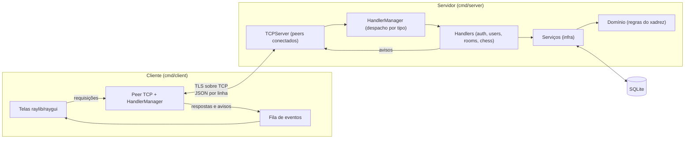
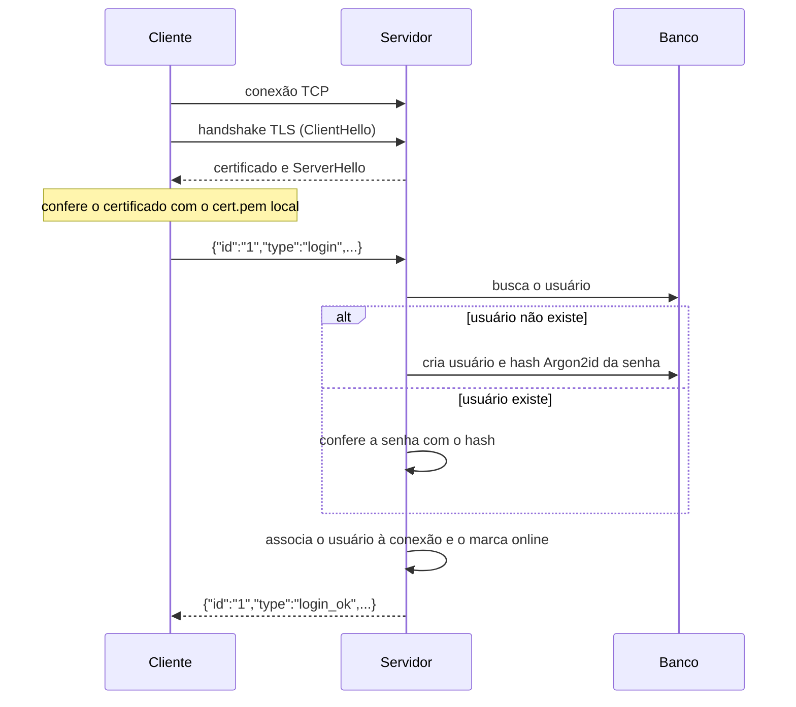
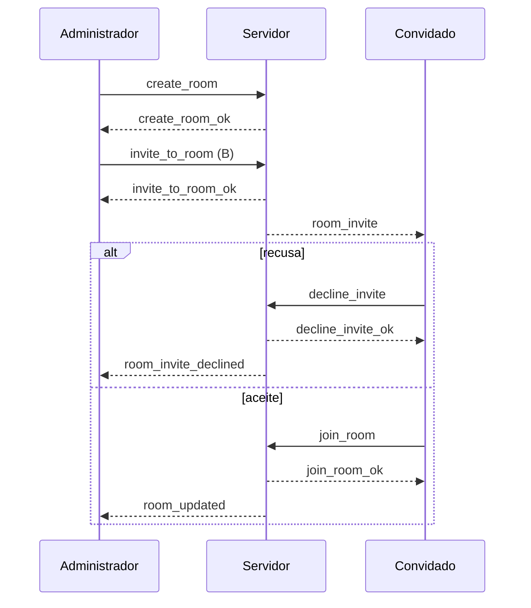
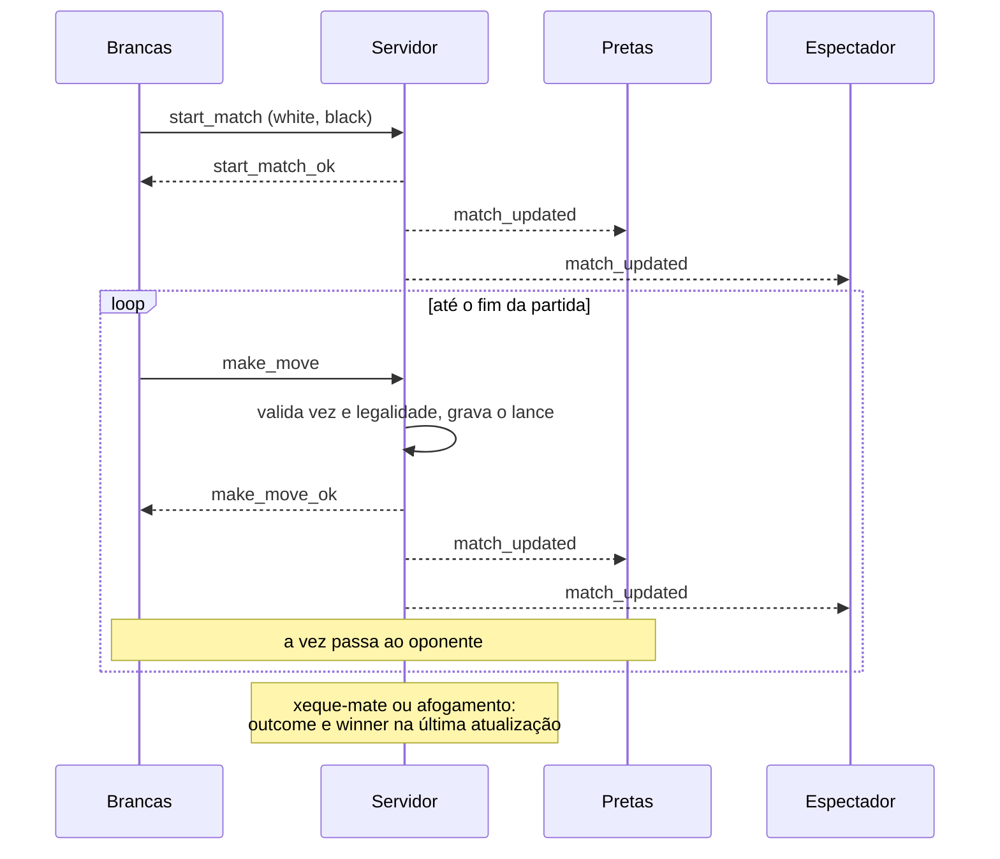
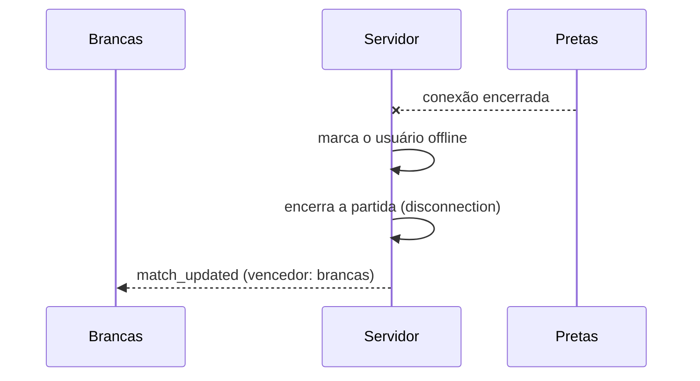
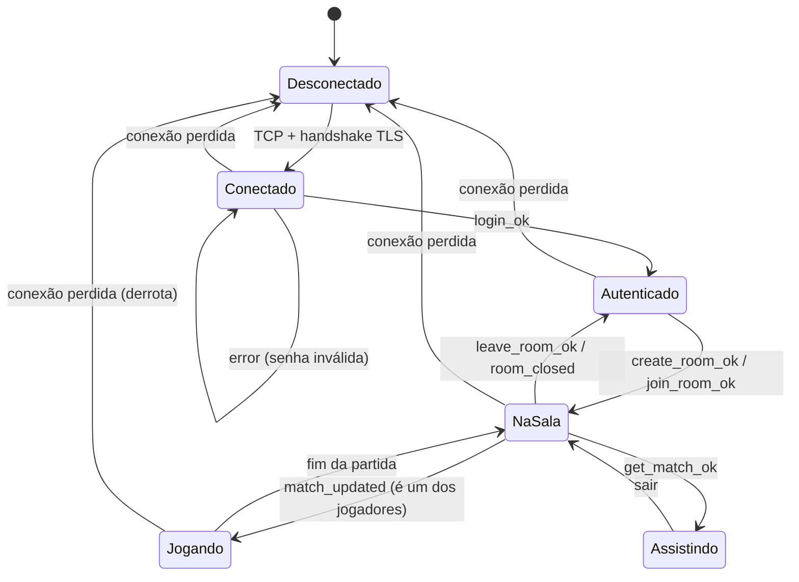
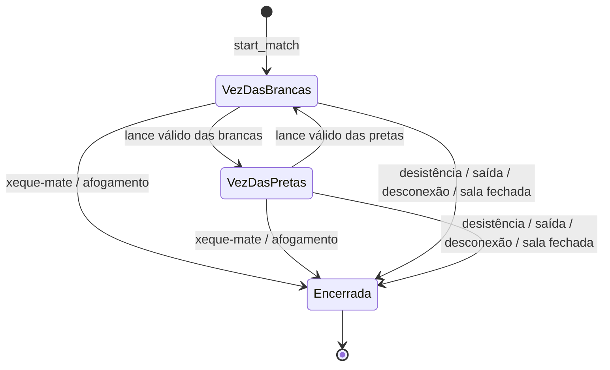

# Xadrez

Xadrez multiplayer em rede, feito para o projeto Capstone da disciplina de Redes de Computadores (camadas de aplicação e transporte). Dois jogadores conectados simultaneamente jogam uma partida com estado consistente, mantido pelo servidor, enquanto outros usuários podem assistir.

O projeto tem três partes:

- **Servidor** (`cmd/server`): autentica usuários, gerencia salas, convites e partidas, valida cada lance e repassa as atualizações a todos os envolvidos.
- **Cliente** (`cmd/client`): interface gráfica em raylib para cadastro/login, lista de usuários online, salas, convites e o tabuleiro.
- **Banco de dados** (SQLite): usuários, senhas (com hash), salas, participantes, partidas e lances.

A comunicação é um protocolo próprio de mensagens JSON sobre **TCP com TLS**.

## Sumário

- [Requisitos atendidos](#requisitos-atendidos)
- [Como executar](#como-executar)
- [Arquitetura e componentes](#arquitetura-e-componentes)
- [Protocolo de comunicação (IPC)](#protocolo-de-comunicação-ipc)
- [Diagramas de sequência](#diagramas-de-sequência)
- [Diagramas de estado](#diagramas-de-estado)
- [Barramento de eventos e turnos](#barramento-de-eventos-e-turnos)
- [Persistência](#persistência)
- [Segurança](#segurança)
- [Bibliotecas e justificativas](#bibliotecas-e-justificativas)
- [Monitoramento e depuração](#monitoramento-e-depuração)
- [Testes](#testes)

## Requisitos atendidos

| # | Requisito do enunciado | Como foi atendido |
|---|---|---|
| 1 | Cadastro de múltiplos usuários com usuário e senha, persistidos com segurança | O primeiro login de um nome cadastra o usuário. A senha é gravada apenas como hash Argon2id com salt aleatório. |
| 2 | Autenticação sem expor dados de registro | Todo o tráfego passa por TLS, e o servidor nunca devolve a senha nem o hash. |
| 3 | Exibir usuários online | Mensagem `list_online_users`, com tela própria no cliente. |
| 4 | Criar jogo e convidar qualquer usuário online | O usuário cria uma sala, vira administrador e convida qualquer usuário online (`invite_to_room`). |
| 5 | Aceitar ou recusar convite | O convite chega em tempo real (`room_invite`). Aceitar faz o usuário entrar na sala (`join_room`); recusar avisa o administrador (`room_invite_declined`). |
| 6 | Fazer lances na sua vez, com o tabuleiro atualizado para os dois | O servidor valida vez e legalidade de cada lance e envia o tabuleiro novo a jogadores e espectadores (`match_updated`). |
| 7 | Mostrar o resultado final aos dois | Xeque-mate, afogamento, desistência, desconexão e sala fechada são enviados a todos, com o vencedor. |
| 8 | Sair do jogo concedendo a vitória | Desistir (`resign`), sair da sala ou desconectar no meio da partida dá a vitória ao oponente. |
| 9 | Monitorar eventos do servidor | Logs estruturados de conexões, cadastros, logins, salas, convites, início e fim de partidas, requisições atendidas (com duração) e erros. |

Além disso, há testes funcionais automatizados que cobrem todos os resultados de partida, e a verificação com Wireshark de que o tráfego está cifrado (veja [Monitoramento e depuração](#monitoramento-e-depuração)).

## Como executar

O ambiente de desenvolvimento vem do `flake.nix` (Go, gopls, ent, netcat). Use `nix develop` ou direnv (`use flake`). As dependências estão em `vendor/`, então não é preciso baixar nada para compilar.

### 1. Gerar o certificado TLS (`cert.pem` e `key.pem`)

O servidor usa um certificado **autoassinado**, gerado localmente. Os arquivos `.pem` não ficam no repositório (estão no `.gitignore`), então cada máquina que vai rodar o servidor precisa gerá-los uma vez.

O próprio Go traz um gerador de certificados, então não é preciso instalar nada. **Na raiz do projeto**, rode:

```sh
go run "$(go env GOROOT)/src/crypto/tls/generate_cert.go" --host localhost
```

O comando cria dois arquivos no diretório atual:

| Arquivo | Conteúdo | Quem usa |
|---|---|---|
| `cert.pem` | Certificado, com a chave pública e o nome do servidor (`localhost`) | O servidor o apresenta no handshake, e o cliente o usa para confiar no servidor |
| `key.pem` | Chave privada | Só o servidor. Nunca deve ser compartilhada nem commitada |

**Pontos importantes:**

- **Diretório:** o servidor e o cliente procuram os arquivos no **diretório em que são executados**. Rode os dois a partir da raiz do projeto, onde os `.pem` foram gerados.
- **Nome do host:** o cliente confere se o endereço configurado bate com o `--host` do certificado. Gerado com `--host localhost`, o cliente precisa conectar em `localhost:9000`, e não em `127.0.0.1:9000`.
- **Servidor em outra máquina:** inclua no `--host` o IP ou nome pelo qual os clientes vão acessá-lo. Vários valores são separados por vírgula, por exemplo `--host localhost,192.168.0.10`. Depois copie o `cert.pem`, **e só ele**, para a pasta de onde o cliente é executado em cada máquina.
- **Validade:** o certificado vale por 1 ano. Para mudar, use `--duration`, por exemplo `--duration 8760h0m0s`.
- **Regenerar:** se o par for gerado de novo, o `cert.pem` dos clientes precisa ser atualizado também. Caso contrário, o cliente recusa a conexão, pois o certificado do servidor deixou de ser o que ele conhece.

Como alternativa ao gerador do Go, o mesmo par pode ser criado com o OpenSSL:

```sh
openssl req -x509 -newkey ec -pkeyopt ec_paramgen_curve:P-256 -nodes \
  -keyout key.pem -out cert.pem -days 365 \
  -subj "/O=Xadrez" -addext "subjectAltName=DNS:localhost"
```

### 2. Subir o servidor

```sh
go run ./cmd/server
```

| Variável de ambiente | Padrão | Uso |
|---|---|---|
| `XADREZ_ADDRESS` | `:9000` | Endereço em que o servidor escuta |
| `XADREZ_DATABASE_DSN` | `file:xadrez.db?_pragma=foreign_keys(1)` | Banco SQLite |

O servidor lê `cert.pem` e `key.pem` do diretório atual, e o esquema do banco é criado ou migrado automaticamente na inicialização.

### 3. Abrir o cliente

```sh
go run ./cmd/client
```

O endereço do servidor (padrão `localhost:9000`) fica em `~/.config/xadrez/client.toml` e pode ser alterado pela tela de configurações do cliente ou pela flag `-config`. O cliente também lê o `cert.pem` do diretório atual. O host do endereço precisa ser `localhost`, porque é o nome que consta no certificado.

### 4. Rodar os testes

```sh
go test ./internal/... ./cmd/...
```

## Arquitetura e componentes



O código segue três camadas em `internal/`:

| Camada | Pacote | Responsabilidade |
|---|---|---|
| Domínio | `internal/domain` | Regras e interfaces de serviço: `chess` (tabuleiro, lances, xeque, mate, afogamento, promoção), `rooms`, `users`, `auth` |
| Infraestrutura | `internal/infra` | Implementação dos serviços com ent/SQLite, hash de senha e o transporte TCP (`internal/infra/tcp`) |
| Aplicação | `internal/application/messages` | Payloads JSON compartilhados entre cliente e servidor |

### Servidor

`cmd/server/main.go` abre o banco, monta os serviços, cria os handlers (`cmd/server/handlers`) e registra cada tipo de mensagem no `HandlerManager`.

- **`TCPServer`** aceita conexões TLS e cria um `Peer` para cada uma, numa goroutine própria. Ele mantém o conjunto de peers conectados e sabe entregar uma mensagem a um usuário específico (`SendToUser`), o que é usado para convites e atualizações de partida.
- **`Peer`** representa uma conexão. A leitura é feita linha a linha e a escrita é assíncrona, por uma fila (`outbox`) com 64 posições. Se a fila enche, porque o cliente não está lendo, a conexão é encerrada, para que um cliente lento não trave o servidor.
- **Sessão:** cada `Peer` tem um `context` que carrega o usuário autenticado (`tcp.SetUser` / `tcp.UserFrom`). A autenticação vale para a conexão inteira; não há token a reenviar a cada mensagem.

### Cliente

O cliente reaproveita o mesmo `Peer` e o mesmo `HandlerManager` do servidor (`tcp.Dial`). Cada mensagem recebida vira um evento numa fila com buffer, consumida pelo laço de renderização a cada quadro, então a leitura da rede nunca bloqueia a interface. As telas são: login/cadastro, lobby, usuários online, salas, sala, partida e configurações.

Cada requisição recebe um `id` sequencial. O cliente guarda a "geração" da tela que fez a requisição e descarta erros de requisições feitas por telas que já foram fechadas.

## Protocolo de comunicação (IPC)

A comunicação entre os processos cliente e servidor usa **sockets TCP**, na camada de transporte, protegidos por **TLS**, com um protocolo de aplicação próprio:

- Cada mensagem é um objeto **JSON numa única linha**, terminado por `\n`.
- Toda mensagem tem o envelope `{id, type, payload}`.
- O cliente envia uma requisição com um `id` único. O servidor responde com o **mesmo `id`** e o tipo `<type>_ok`, ou com o tipo `error`.
- Avisos que o servidor envia por conta própria, como convites e lances do oponente, vêm **sem `id`**.

```json
{"id":"1","type":"login","payload":{"name":"ana","password":"segredo"}}
{"id":"1","type":"login_ok","payload":{"token":"0198f6a2-..."}}

{"id":"7","type":"make_move","payload":{"room":"sala","from_x":4,"from_y":6,"to_x":4,"to_y":4}}
{"id":"7","type":"error","payload":{"message":"não é a vez das pretas"}}
```

Erros de regra de negócio, como lance ilegal ou falta de permissão, têm a mensagem repassada ao cliente. Qualquer outro erro, por exemplo uma falha no banco, é registrado no log e chega ao cliente apenas como `"erro interno do servidor"`, sem expor detalhes internos.

### Requisições

Todas as requisições, exceto `login`, exigem uma conexão autenticada.

| Tipo | Payload | Resposta (`<tipo>_ok`) |
|---|---|---|
| `login` | `name`, `password` | `token` |
| `list_online_users` | (vazio) | `users` (lista de nomes) |
| `create_room` | `room` | sala |
| `join_room` | `room` | sala |
| `list_rooms` | (vazio) | `rooms` (lista de salas) |
| `invite_to_room` | `room`, `user` | convite |
| `decline_invite` | `room` | convite |
| `leave_room` | `room` | `room`, `closed` |
| `start_match` | `room`, `white`, `black` | partida |
| `get_match` | `room` | partida |
| `make_move` | `room`, `from_x`, `from_y`, `to_x`, `to_y`, `promotion` (opcional) | partida |
| `resign` | `room` | partida |

### Avisos do servidor

| Tipo | Para quem | Payload |
|---|---|---|
| `room_invite` | Convidado | convite |
| `room_invite_declined` | Administrador da sala | convite |
| `room_updated` | Participantes da sala, quando alguém entra ou sai | sala |
| `room_closed` | Participantes, quando o administrador fecha a sala | `room`, `closed` |
| `match_updated` | Participantes, a cada início, lance ou fim de partida | partida |

### Payloads

- **Sala:** `{"room":"sala","admin":"ana","participants":["ana","bob"]}`
- **Convite:** `{"room":"sala","from":"ana","to":"bob"}`
- **Partida:**

  ```json
  {
    "room": "sala",
    "white": "ana",
    "black": "bob",
    "turn": 1,
    "in_check": false,
    "outcome": "checkmate",
    "winner": "bob",
    "pieces": [[{"kind": 3, "color": 0}, null, "..."], "..."]
  }
  ```

  - `pieces[x][y]` é o tabuleiro 8×8. `x` é a coluna (a–h → 0–7) e `y` é a fileira (1–8 → 0–7); as brancas começam em `y` 0 e 1.
  - `kind` é a peça: 0 peão, 1 cavalo, 2 bispo, 3 torre, 4 dama, 5 rei.
  - `color` e `turn` são a cor: 0 brancas, 1 pretas.
  - `outcome` fica ausente enquanto a partida está em andamento. Ao terminar, assume `checkmate`, `stalemate`, `resignation`, `disconnection` ou `room_closed`, e `winner` traz o vencedor (vazio em empate ou sala fechada).

## Diagramas de sequência

### Login e cadastro



### Convite: recusa e aceite



### Partida



### Desconexão durante a partida



## Diagramas de estado

### Conexão do cliente



### Partida



Uma sala tem no máximo uma partida em andamento. Quando ela termina, o administrador pode iniciar outra na mesma sala.

## Barramento de eventos e turnos

O barramento de eventos do servidor é o próprio **`HandlerManager`**, em `internal/infra/tcp/common.go`. Cada tipo de mensagem é registrado uma única vez com um handler tipado (`RegisterRequestHandler`), e cada mensagem recebida é desserializada e despachada pelo seu `type`. Eventos de ciclo de vida, como a desconexão, também passam pelo barramento: vários handlers podem se inscrever com `RegisterDisconnectHandler`. Um deles marca o usuário como offline e outro encerra as partidas em andamento dele.

O controle de turnos fica no domínio. O `Game` guarda de quem é a vez e recusa lances fora dela ou de peças do adversário. As ações de uma partida são processadas dentro de uma transação no banco, e o número do lance (`ply`) tem índice único por partida. Se dois lances concorrentes chegarem ao mesmo tempo, só um é gravado e o outro recebe "o tabuleiro mudou antes do lance, tente novamente".

## Persistência

Os schemas ficam em `ent/schema/`. Todos têm id UUIDv7, `created_at` e `updated_at`.

| Entidade | Conteúdo |
|---|---|
| `User` | Nome único (letras minúsculas, números, `_` e `-`) |
| `UserPassword` | Hash Argon2id da senha, marcado como sensível |
| `GameRoom` | Nome único, administrador e status (ativa ou fechada) |
| `Participant` | Usuário numa sala; `left_at` marca quem saiu |
| `Match` | Sala, participantes branco e preto, resultado, tipo de término e `finished_at` |
| `MatchMove` | Lance (`ply`, origem, destino e promoção) |

As partidas não guardam o tabuleiro: ele é **reconstruído a partir do histórico de lances** a cada requisição. Assim, o banco é a única fonte de verdade e o estado é o mesmo para todos os clientes.

## Segurança

| Ameaça | Proteção |
|---|---|
| Escuta do tráfego (senha, lances) | Toda a comunicação usa TLS 1.3. No Wireshark, só aparecem registros `Application Data` cifrados. |
| Man in the middle | O cliente confia **apenas** no certificado do servidor (`cert.pem` em `RootCAs`) e verifica o nome do host. A verificação de certificado nunca é desligada (`InsecureSkipVerify`), então um servidor com outro certificado é recusado. |
| Adulteração de mensagens | O TLS 1.3 usa cifras autenticadas (AEAD, como AES-GCM): um registro alterado no caminho derruba a conexão. |
| Vazamento do banco de senhas | As senhas são guardadas só como hash Argon2id, com salt aleatório de 16 bytes por senha, e comparadas em tempo constante. |
| Cliente trapaceando | Toda regra é validada no servidor: vez, dono da peça, legalidade do lance, permissões de administrador e participação na sala. |
| Vazamento de detalhes internos | Erros inesperados chegam ao cliente apenas como "erro interno do servidor"; os detalhes ficam no log. |
| Mensagens enormes ou cliente lento | A leitura recusa linhas acima de 64 KB e encerra a conexão; a fila de saída cheia também encerra a conexão. |

**Limitações conhecidas:** ainda não há limite de tentativas de login nem timeout para conexões ociosas ou handshakes que não terminam. O certificado é autoassinado, então precisa ser distribuído aos clientes.

## Bibliotecas e justificativas

O projeto é escrito em **Go**. O enunciado sugere .NET, C# ou Java; escolhemos Go porque a biblioteca padrão já cobre tudo o que a parte de rede exige, sem dependências externas: sockets (`net`), TLS (`crypto/tls`, `crypto/x509`) e JSON (`encoding/json`). Além disso, goroutines permitem atender cada conexão com um fluxo próprio, de forma simples e barata, e o resultado é um binário estático fácil de distribuir.

| Biblioteca | Uso | Por quê |
|---|---|---|
| `net`, `crypto/tls`, `crypto/x509` (padrão) | Sockets e TLS | Implementação oficial e auditada, sem dependências externas. `tls.Conn` implementa a mesma interface `net.Conn`, então ativar o TLS não exigiu mudar o resto do transporte. |
| `encoding/json` (padrão) | Serialização das mensagens | Formato textual, legível em logs e capturas durante o desenvolvimento, e com suporte nativo a tipos genéricos de payload. |
| `golang.org/x/crypto/argon2` | Hash de senha | Argon2id, vencedor da Password Hashing Competition e recomendado pela OWASP para senhas. |
| `entgo.io/ent` | ORM e migrações | Schema em código, consultas tipadas, transações e migração automática. |
| `modernc.org/sqlite` | Banco | SQLite em Go puro (sem cgo): o servidor compila sem toolchain C, e o banco é um único arquivo. |
| `charm.land/log` | Logs | Logs estruturados (chave=valor), fáceis de ler e filtrar. |
| `github.com/gen2brain/raylib-go` (raylib + raygui) | Interface do cliente | Biblioteca gráfica simples, multiplataforma, com widgets básicos prontos. |
| `github.com/BurntSushi/toml` | Configuração do cliente | Formato legível para o arquivo de configuração. |
| `github.com/google/uuid` | Identificadores | UUIDv7, ordenáveis pelo tempo de criação. |

## Monitoramento e depuração

### Logs do servidor

O servidor registra em logs estruturados todos os eventos relevantes. Exemplos reais:

```text
INFO  servidor iniciado endereço=[::]:9000
INFO  cliente conectado cliente=[::1]:49550
INFO  novo usuário registrado usuário=ana
INFO  usuário autenticado com sucesso usuário=bob
INFO  requisição atendida tipo=login cliente=[::1]:49550 usuário=ana id=1 duração=43.5ms
INFO  sala criada sala=sala administrador=ana
INFO  convite enviado sala=sala administrador=ana convidado=bob
INFO  partida iniciada sala=sala brancas=ana pretas=bob
INFO  partida encerrada sala=sala resultado=checkmate vencedor=bob
WARN  falha ao processar requisição tipo=make_move erro="não é a vez das pretas"
INFO  usuário desconectado usuário=bob
```

Cada requisição atendida aparece com tipo, cliente, usuário, `id` e duração, o que permite acompanhar a correlação com o cliente e a latência.

### Testar o protocolo manualmente

Com o servidor rodando, o `openssl` abre uma sessão TLS em que se pode digitar as mensagens JSON diretamente:

```sh
openssl s_client -quiet -connect localhost:9000
{"id":"1","type":"login","payload":{"name":"ana","password":"segredo"}}
```

O `nc` não funciona com o servidor, porque ele exige TLS.

### Verificação com Wireshark

1. **Capturar o tráfego.** Capture a interface de loopback (`lo`) na porta do servidor. No NixOS, sem o Wireshark configurado no sistema, capture com o `dumpcap` e abra o arquivo depois:

   ```sh
   sudo dumpcap -i lo -f "tcp port 9000" -w /tmp/xadrez.pcapng
   ```

2. **Gerar tráfego.** Faça login pelo cliente com uma senha conhecida e jogue alguns lances.
3. **Procurar a senha.** No Wireshark, aplique o filtro `frame contains "suasenha"`:
   - **Com TLS**, nenhum pacote aparece. O filtro `tls` mostra o handshake (`Client Hello`, `Server Hello`) e depois só registros `Application Data`, cujo conteúdo é ilegível em *Follow → TLS Stream*.
   - **Sem TLS** (versão anterior à integração), o pacote do login aparece e *Follow → TCP Stream* mostra o JSON com a senha em texto puro.
4. **Conferir a cifra.** No `Server Hello` aparece a cipher suite negociada, por exemplo `TLS_AES_128_GCM_SHA256`. O GCM é uma cifra autenticada, o que garante a integridade das mensagens.

## Testes

```sh
go test ./internal/... ./cmd/...
```

| Pacote | Cobertura |
|---|---|
| `internal/domain/chess` | Movimento de cada peça, caminho livre, xeque, cravada, xeque-mate, afogamento, promoção e lances legais |
| `internal/infra` | Hash e verificação de senha, cadastro e login, usuários online, salas (criar, entrar, sair, fechar), convites (enviar, recusar) e partidas (regras, persistência, reconstrução pelo histórico e todos os resultados), com SQLite em memória |
| `internal/infra/tcp` | Protocolo: correlação por `id`, mensagens malformadas, tipos desconhecidos, erros que podem ou não chegar ao cliente, usuário associado à conexão e eventos de desconexão |
| `cmd/server` | **Testes funcionais de ponta a ponta:** o servidor real num socket local, com clientes trocando JSON. Cobrem login, usuários online, convites, saída e fechamento de sala e **todos os resultados de partida** (xeque-mate, afogamento, desistência, desconexão e sala fechada), conferindo que jogadores e espectadores recebem o mesmo estado |
| `cmd/client/config` | Leitura e gravação da configuração do cliente |

O progresso do projeto e os itens planejados ficam em [`ROADMAP.md`](ROADMAP.md).
